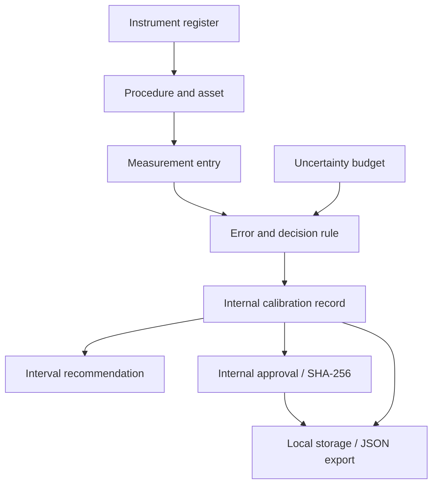

# Metrology OS V4 — Studio Niko Design

**Browser-native measurement management, uncertainty budgets and traceable internal calibration records.**

Une GMAO métrologique multisectorielle pour structurer les équipements, procédures, interventions et décisions de mesure sans serveur obligatoire.

    

**STUDIO NIKO DESIGN** · Build smart. Stay lightweight. Create without limits.

[English overview](#english-overview) · [Quickstart](#quickstart--démarrage-rapide) · [Issues](https://github.com/Nikoju1977/Metrology-OS/issues)

## Qualification métrologique — cas de référence proposés

**Priorité P0 : aucune libération de produit sur la base de ce prototype.** La synthèse de conformité peut rester verte malgré un point non évalué ; une incertitude non renseignée peut être assimilée à zéro. Ces défauts sont présents dans le code inspecté et ne sont pas corrigés par cette documentation.

Les cas ci-dessous sont des oracles de calcul construits sur des données fictives, non des résultats de tests exécutés. Toutes les valeurs d'un même cas utilisent une unité cohérente.

| Cas | Entrée synthétique | Résultat attendu |
| --- | --- | --- |
| Somme quadratique | Deux incertitudes-types directes 3 et 4, coefficients 1, indépendance supposée | uc = 5 ; U = 10 pour k = 2 |
| Limite de conformité | E = 8 ; U = 2 ; tolérance = 10 | Conforme selon la règle implémentée |
| Zone de garde | E = 9 ; U = 2 ; tolérance = 10 | Zone de garde |
| Non-conformité | E = 13 ; U = 2 ; tolérance = 10 | Non conforme |
| Donnée absente | Référence, indication, incertitude ou tolérance manquante | Bloquer toute décision globale de libération ; correction nécessaire |
| Coefficient nul | Contribution avec coefficient de sensibilité 0 | Contribution nulle ; le traitement actuel doit être corrigé |

Le facteur k = 2 n'établit pas à lui seul une probabilité de couverture donnée. Documenter les distributions, corrélations, unités, incertitudes des étalons et règles de décision approuvées. Une empreinte SHA-256 locale ne suffit pas à établir la traçabilité métrologique, laquelle requiert notamment une chaîne documentée d'étalonnages et leurs incertitudes.

**English:** Proposed reference cases cover uncertainty propagation, decision boundaries and missing inputs. No runtime execution or qualification was performed. Product release must remain blocked pending independent validation and remediation. Normative references are retained, not independently reassessed in this documentation revision.

> **Prototype non qualifié.** Inspection statique du code uniquement : aucun nouveau test d'exécution, audit de sécurité, benchmark, test physique, validation industrielle ou clinique n'a été effectué pour cette révision. Utiliser des données synthétiques.

## Pourquoi ce projet ?

Rassembler le suivi métrologique et les méthodes de décision dans une interface directement exploitable pour la démonstration et la qualification. Le calcul déterministe est lisible et reproductible en principe, sans dépendance à un LLM. Les référentiels sont des références de travail, non des preuves de conformité.

## Fonctionnalités clés

- 📏 Bibliothèque d'instruments, recherche multicritère, parc, échéances et alertes.
- 📋 Registre des procédures avec indices, statuts, rédacteur, vérificateur et approbateur déclarés.
- 🧮 Budget d'incertitude simplifié, calcul des erreurs et règle de décision par bande de garde.
- 📊 Historique d'étalonnage et périodicités proposées selon criticité, échecs et dérives.
- 🔐 Approbation interne avec empreinte SHA-256, identification QR, certificats internes imprimables et export JSON.

## Architecture & sécurité



### Algorithmes inspectés

| Fonction dans `index.html` | Méthode réelle |
| --- | --- |
| `calcUncertainty` | Normale : valeur / diviseur ; rectangulaire : valeur / √3 ; triangulaire : valeur / √6 ; directe : valeur ; multiplication par coefficient de sensibilité, somme quadratique, U = 2 uc. |
| `computeOpPoints` | E = indication − référence ; conforme si abs(E) + U ≤ tolérance, non conforme si abs(E) − U > tolérance, sinon zone de garde ; tolérance absente ou nulle = non évalué. |
| `calcAssetRecommendation` | Intervalle de base multiplié par facteurs heuristiques (criticité, non-conformités, variation de l'erreur maximale, trois dernières interventions), borné entre 3 et 36 mois. |
| `createApproval` / `sha256` | Hachage de la sérialisation JSON de l'enregistrement, de l'identité déclarée, du commentaire et de l'horodatage local. Web Crypto avec repli SHA-256 JavaScript. |

### Points critiques à corriger avant usage professionnel

- L'incertitude utilise k=2 et ne traite pas les covariances ni les degrés de liberté. La saisie vide est parfois assimilée à zéro, et un coefficient de sensibilité nul est remplacé par 1 ; valider les entrées et les cas limites.
- La synthèse verte de `computeOpPoints` peut apparaître lorsque des points sont incomplets ou non évalués. Ne pas interpréter cet affichage comme une libération de produit. Le statut global est saisi séparément ; une règle de blocage et une validation humaine sont nécessaires.
- La périodicité est une suggestion heuristique, pas une règle réglementaire ni une optimisation statistique validée. Ne pas prolonger un intervalle réglementaire à partir de ce calcul.
- Le stockage `localStorage` (avec repli mémoire) est modifiable, non chiffré et non partagé. Des suppressions sont possibles. Le nom et la fonction de l'approbateur sont déclaratifs, l'heure provient du poste et l'empreinte n'est ni une signature numérique authentifiée ni un journal inaltérable. Le code inspecté ne démontre pas une vérification indépendante et systématique de l'empreinte lors de la consultation. Les QR encodent notamment des données d'équipement en clair.
- Le code embarque un générateur QR tiers (avis MIT de Kazuhiko Arase visible) : aucune dépendance à installer n'est requise, mais ce n'est pas une absence de code tiers.

## Référentiels et limites de conformité

| Référentiel | Positionnement |
| --- | --- |
| [ISO 10012:2026](https://www.iso.org/standard/10012) | Management de la mesure : suivi des équipements et processus à qualifier. |
| [ISO/IEC 17025:2017](https://www.iso.org/standard/66912.html) | Compétence des laboratoires : références, incertitudes, traçabilité et décisions à valider ; pas d'accréditation. |
| [JCGM 100 et JCGM 106](https://www.bipm.org/en/web/guest/publications/guides) | Guides pour incertitude et évaluation de conformité ; modèle du prototype non validé. |
| ISO 9001 et référentiels sectoriels | Gestion documentaire et suivi des ressources de mesure ; applicabilité à déterminer. |

Le catalogue de normes intégré indique une date de vérification au 24 septembre 2026 ; ce README ne constitue pas une revue de toutes ses notices. Les textes protégés ne sont pas redistribués. Aucune conformité à ISO 13485, IEC 62304 ou FDA 21 CFR Part 11 n'est revendiquée.

## Quickstart / Démarrage rapide

Ouvrir `index.html` ou lancer `python3 -m http.server 8000` à la racine, puis http://localhost:8000/. Utiliser exclusivement des données fictives pour les essais ; consulter une fiche instrument, saisir des valeurs de référence et exporter le registre JSON. L'export n'établit pas une restauration validée.

## Documentation technique historique

Les informations antérieures ci-dessous sont conservées pour le contexte ; les constats de l'inspection statique et les limites explicites ci-dessus priment sur toute formulation historique trop générale.

GMAO métrologique autonome en HTML : parc instruments, procédures, étalonnages, périodicités, incertitudes, certificats, conformité, référentiels et recherche.

## Version
Metrology OS V4 — base multi-domaines avec procédures maîtrisées et recherche intégrée au tableau des instruments.

## Utilisation
Ouvrir `index.html` dans un navigateur moderne.

## Référentiels
Les références normatives sont identifiées et reliées à leurs sources officielles quand disponibles. Les textes complets des normes protégées (ISO, IEC, AFNOR, RCC-M/AFCEN, etc.) ne sont pas redistribués ; leur consultation reste soumise aux droits/licences applicables.

## Données
Le prototype fonctionne principalement côté navigateur. Pour une utilisation industrielle multi-utilisateur, prévoir une base de données, authentification, sauvegardes, gestion des rôles et veille normative serveur.


## Démarrage et périmètre

**Thème : industrie · métrologie · gestion des équipements.** Aucun installateur n'est nécessaire pour l'interface actuelle : ouvrir `index.html` ou lancer `python3 -m http.server 8000` dans le dossier du projet, puis visiter http://localhost:8000/.

Cette interface vise une **démonstration de méthodes de suivi**, pas la production d'un certificat d'étalonnage accrédité. Les résultats et décisions de conformité doivent être confirmés par une procédure maîtrisée, des équipements étalonnés et des personnes compétentes. Les références aux normes ne constituent pas une certification ISO ni une autorisation de redistribution de leurs textes.

## Points à valider pour une mise en production

- Traçabilité des mesures, des versions de procédures et des décisions.
- Sauvegardes, gestion des rôles et journal d'audit immuable.
- Tests de calculs d'incertitude avec cas de référence validés.
- Contrôles d'accessibilité et essais multi-navigateurs.

**Statut :** prototype navigateur ; aucune qualification métrologique ou mise en production n'est attestée par ce README.

[Catalogue des projets Studio Niko Design](https://github.com/Nikoju1977).


## Utilisation et vérifications

Le dépôt contient une application autonome en `index.html`. Pour la consulter dans un navigateur moderne, ouvrir ce fichier ou démarrer un serveur local :

```bash
python3 -m http.server 8000
```

Puis accéder à http://localhost:8000/.

**Avant un déploiement professionnel :** inventorier les données enregistrées par l'interface, vérifier leur sauvegarde et leur restauration, définir les profils d'accès, valider les calculs d'incertitude sur des cas de référence et conserver la traçabilité des procédures appliquées. Une interface de métrologie ne constitue pas à elle seule une preuve de conformité à un référentiel ISO.

**Maturité :** prototype ; aucun audit de certification, contrôle métrologique indépendant ni test navigateur n'est revendiqué ici.

[Voir les autres projets Studio Niko Design](https://github.com/Nikoju1977).

## Roadmap & contribution

Propositions non terminées :

- [ ] Corriger les validations d'entrée, les états non évalués et la règle de libération.
- [ ] Valider les calculs sur jeux de référence indépendants et documenter les hypothèses.
- [ ] Mettre en place identité, droits, sauvegarde/restauration, journal append-only protégé et vérification d'intégrité.
- [ ] Qualifier la veille normative, les périodicités et les procédures par domaine.

**Première contribution / `good first issue` (label proposé, non créé ici) :** Proposer un cas synthétique de calcul d'incertitude ou de bande de garde avec résultat attendu indépendant. Les rapports reproductibles sont bienvenus dans les [issues](https://github.com/Nikoju1977/Metrology-OS/issues). Ne publier aucune donnée personnelle, industrielle, médicale ou confidentielle. Toute modification ou redistribution reste soumise aux droits existants.

## English overview

Metrology OS is a browser-based measurement management prototype with instrument and procedure registers, calibration records, a simplified uncertainty budget, a guard-band rule, interval suggestions and internal approval hashes. Local storage is editable and not encrypted; an approval hash is not an authenticated signature or immutable audit trail. Input-validation gaps, incomplete-point handling and the fixed coverage factor require correction and independent validation. It is not an accredited calibration system. Serve the root over localhost or open index.html with synthetic data.

No new runtime, security, clinical or industrial validation was performed during this documentation update. Feedback is welcome within the existing rights framework.

## Licence & auteur / License & author

**© 2026 Studio Niko Design — [Nikoju1977](https://github.com/Nikoju1977).** [Notice de droits / Copyright notice](LICENSE.md) : tous droits réservés pour les contributions originales concernées ; l'accès public au code ne constitue pas une licence open source. Les composants tiers conservent leurs licences propres. Aucun fichier de licence n'a été modifié.
